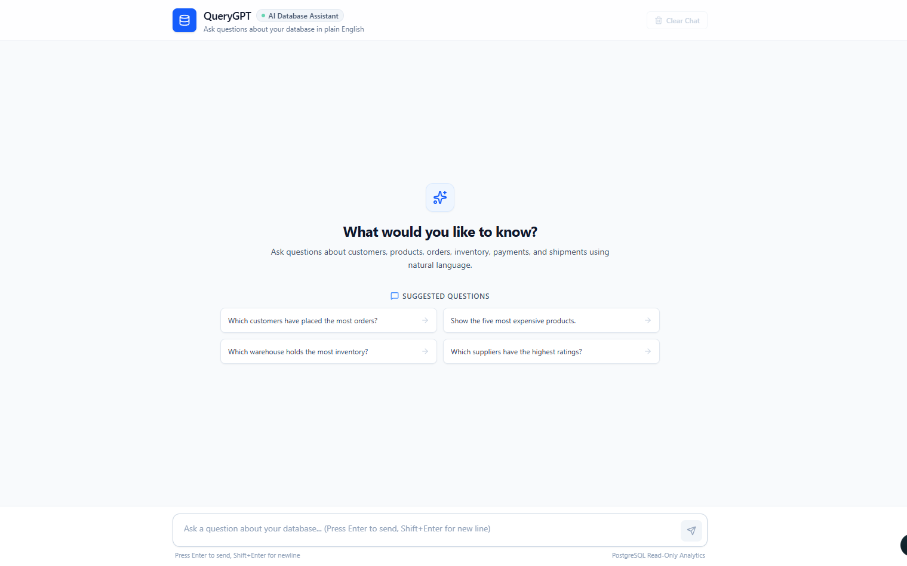
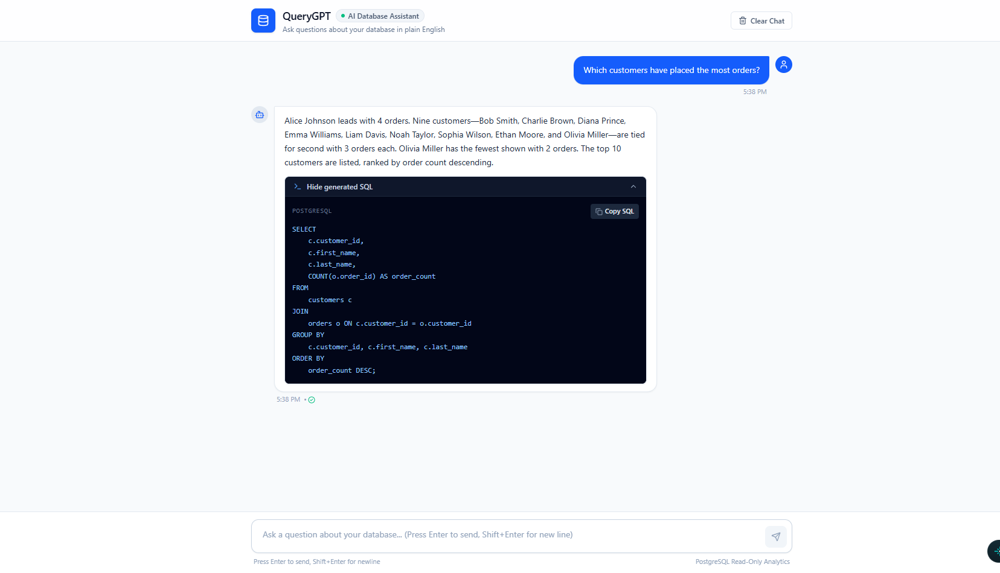
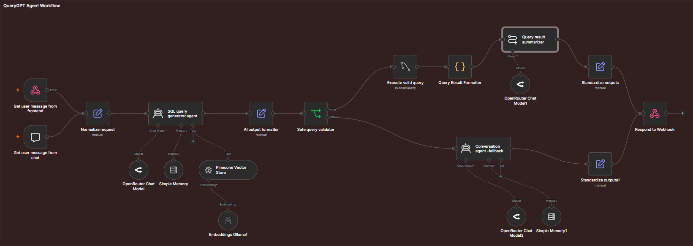
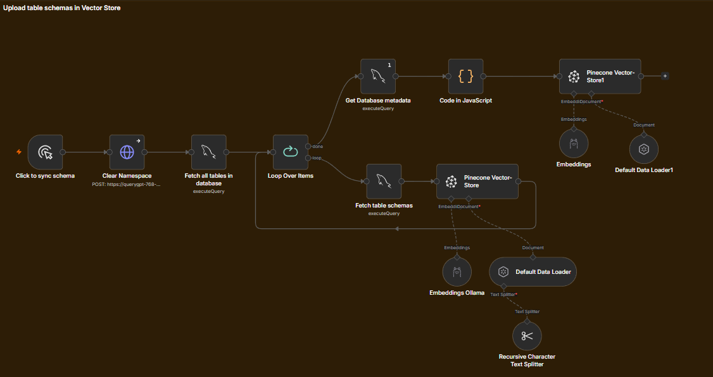

# QueryGPT - Natural Language to SQL Assistant

QueryGPT is an AI-powered assistant that lets users ask questions about a MySQL database in natural language and receive meaningful answers without writing SQL manually.

It uses **Retrieval-Augmented Generation (RAG)** to retrieve relevant database schemas from Pinecone, generate SQL queries, validate them before execution, and summarize query results in plain English. Users can interact with it through the n8n chat interface or a React frontend connected through a webhook. 

Benchmarked performance across **30 test scenarios** spanning 7 query-complexity domains, achieving **90% strict accuracy** and a **91.7% weighted score.**

## Key Features

- **RAG-based Schema Retrieval:** Retrieves relevant table schemas from Pinecone to provide context for SQL generation.
- **Automated Schema Indexing:** Extracts MySQL table definitions using `SHOW CREATE TABLE` and indexes them in Pinecone.
- **Schema Refresh:** Clears existing vectors before re-indexing to prevent stale or duplicate schema records.
- **Metadata Enrichment:** Adds table-level metadata to schema documents to improve retrieval and identification.
- **Database Overview Indexing:** Stores database-level metadata separately to answer questions about available tables and database structure.
- **SQL Validation:** Checks generated queries against an allowlist of permitted SQL statement patterns before execution.
- **Natural Language Summarization:** Converts SQL query results into plain-English explanations.
- **Fallback Agent:** Handles greetings, invalid requests, and queries that cannot be answered using the retrieved context.
- **Dual Chat Interfaces:** Supports the n8n chat interface and a React frontend through an HTTP webhook.
- **Structured API Response:** Returns the answer, request type, and generated SQL in a consistent JSON format.

## Screenshots

### Chat Interface
See it live - https://querygpt.netlify.app/

### n8n Workflow
AI agent workflow

DB Schema Upload workflow

## Example Interaction
User: Which customers have placed the most orders?

QueryGPT converts the question into SQL, validates and runs it on MySQL, then explains the results in simple English.
Frontend API Response
The webhook returns a JSON response with three fields: answer, requestType, and sql.

## Technology Stack

| Component | Technology |
|---|---|
| Workflow orchestration | n8n |
| Database | MySQL |
| Vector database | Pinecone |
| Embedding model | Ollama — `nomic-embed-text` |
| Chat model | OpenRouter |
| Retrieval approach | Retrieval-Augmented Generation (RAG) |
| Frontend | React |
| API integration | n8n Webhook |

## QueryGPT Evaluation Scorecard

### Overall Results

| Metric | Value |
|---|---:|
| Total Test Cases | 30 |
| Correct | 27 |
| Partially Correct | 1 |
| Incorrect | 2 |
| Evaluated Tests | 30 |
| **Strict Accuracy** | **90.0%** |
| **Weighted Score** | **91.7%** |

### Scoring Methodology

| Metric | Formula |
|---|---|
| Strict Accuracy | Correct / Evaluated Tests |
| Weighted Score | (Correct + 0.5 × Partially Correct) / Evaluated Tests |

### Evaluation by Category

| Category | Total Tests | Evaluated |
|---|---:|---:|
| Core retrieval, filters & sorting | 7 | 7 |
| Aggregations & ranking | 4 | 4 |
| Joins & relationships | 3 | 3 |
| Date & time queries | 2 | 2 |
| Schema & database knowledge | 3 | 3 |
| Ambiguity, unsupported requests & fallback | 5 | 5 |
| Safety, error handling & API contract | 6 | 6 |
| **Total** | **30** | **30** |

## Safety and Limitations

QueryGPT is designed for read-oriented database access, and its workflow checks generated SQL before execution. For stronger protection, use a dedicated MySQL account with read-only permissions and apply query timeouts and result limits.

*The frontend requires n8n to be running locally to be able to generate responses.*

The current validator uses a pattern-based check rather than a full SQL parser, so it should not be treated as a complete SQL security boundary. The assistant's answers also depend on the accuracy of the indexed schema and the context retrieved from Pinecone.
